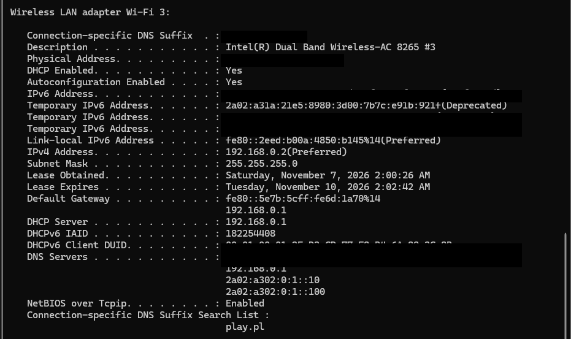

# Windows Network Troubleshooting

## Project Overview

This project documents hands-on Windows network troubleshooting exercises performed using Windows PowerShell and built-in Windows networking utilities.

The goal is to develop practical IT Help Desk skills by learning how to inspect network configurations, diagnose connectivity problems, investigate DNS resolution, and troubleshoot TCP connections.

The exercises are based on practical testing and realistic technical support scenarios.

## Practical Evidence

### Network Configuration

The following screenshot shows the Wi-Fi adapter configuration
collected using `ipconfig /all`.

## Technologies and Tools

The following tools and utilities were used throughout the practical exercises:

### Operating System
- Windows 10/11

### Command-Line Environment
- Windows PowerShell
- Command Prompt (CMD)

### Network Configuration
- `ipconfig`
- `Get-NetAdapter`
- `Get-NetIPConfiguration`
- `route print`
- `arp`

### DNS Troubleshooting
- `nslookup`
- `Resolve-DnsName`
- `Get-DnsClientCache`

### Connectivity Testing
- `ping`
- `tracert`
- `pathping`

### TCP and Process Investigation
- `Test-NetConnection`
- `Get-NetTCPConnection`
- `Get-Process`
- `Get-CimInstance`

## 1. Network Configuration and Inspection

The first part of the project focused on understanding the computer's network configuration and identifying the network interfaces available on Windows.

### Commands Practised

| Command | Purpose |
|---|---|
| `ipconfig /all` | Displays detailed network configuration, including IP addresses, DNS servers, DHCP and default gateway. |
| `Get-NetAdapter` | Lists network adapters and their operational status. |
| `Get-NetIPConfiguration` | Displays IP configuration for network interfaces. |
| `route print -4` | Displays the IPv4 routing table. |
| `arp -a` | Displays the ARP cache, mapping local IPv4 addresses to MAC addresses. |

### Practical Findings

During the exercises, I identified:

- The active Wi-Fi network adapter.
- The computer's IPv4 address and subnet configuration.
- The default gateway used to reach external networks.
- Physical and virtual network adapters.
- The default route used for IPv4 traffic.
- The relationship between IP addresses and MAC addresses through ARP.

### Key Concepts Learned

- IPv4 addressing and subnet masks.
- Default gateways and routing.
- DHCP and DNS configuration.
- Physical versus virtual network adapters.
- ARP address resolution.
- How Windows determines where to send network traffic.

  ## Project Documentation

The project is organised into practical guides covering different areas of Windows network troubleshooting.

| Documentation | Topics |
|---|---|
| [Network Configuration](docs/01-network-configuration.md) | IP addressing, network adapters, routing and ARP |
| [DNS Troubleshooting](docs/02-dns-troubleshooting.md) | DNS resolution, DNS records and caching |
| [Connectivity Testing](docs/03-connectivity-testing.md) | Ping, tracert and pathping |
| [TCP Ports and Processes](docs/04-tcp-ports-and-processes.md) | TCP connectivity, listening ports and process identification |
| [Troubleshooting Scenarios](docs/05-troubleshooting-scenarios.md) | Practical Help Desk network troubleshooting cases |

## Learning Outcomes

Through these practical exercises, I developed familiarity with:

- Inspecting Windows network configurations.
- Understanding IPv4, subnet masks and default gateways.
- Investigating DNS resolution and caching.
- Testing network connectivity and tracing routes.
- Identifying TCP listening ports and associated processes.
- Applying a structured approach to network troubleshooting.

## Environment

The exercises were performed on a Windows computer using Windows PowerShell, Command Prompt and built-in Windows diagnostic utilities.

The results documented in this repository are based on practical exercises and observations from the lab environment.
